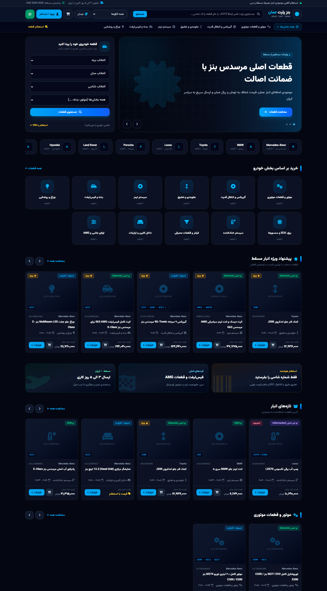
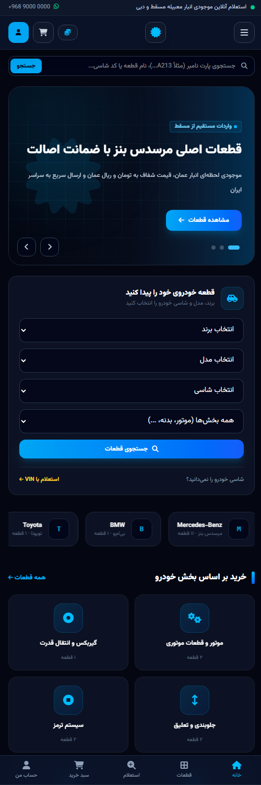
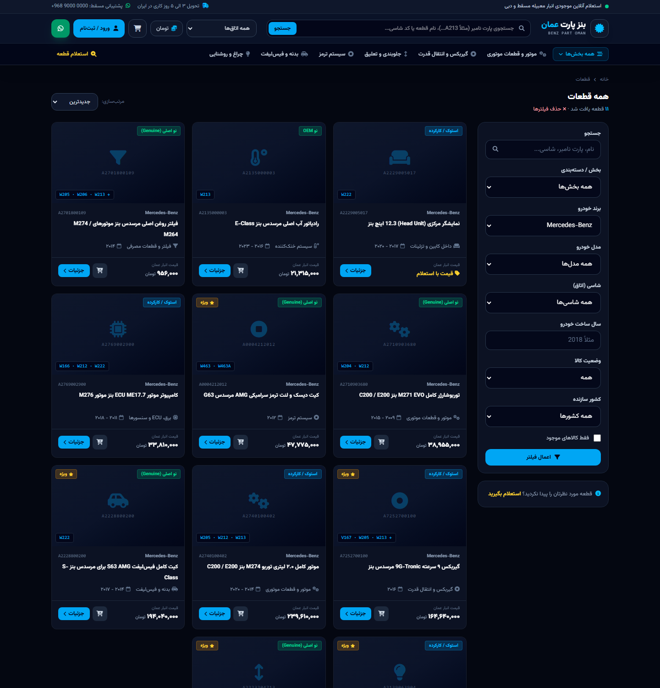
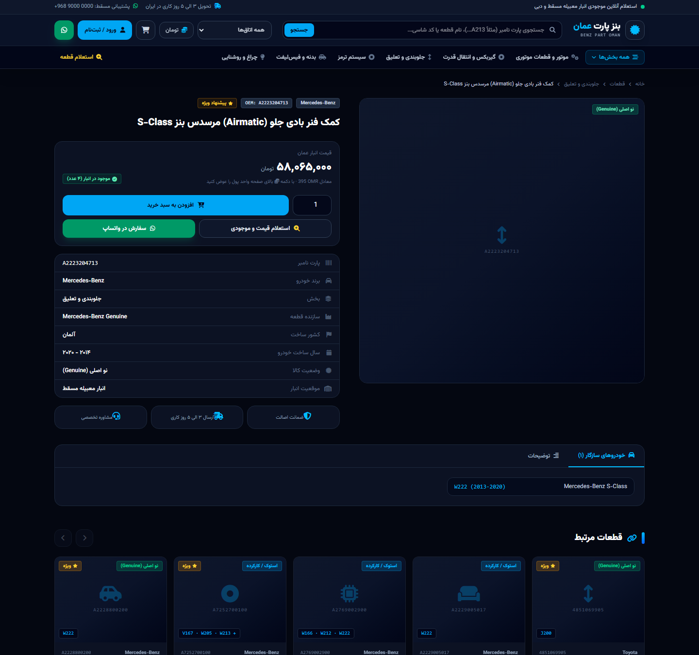
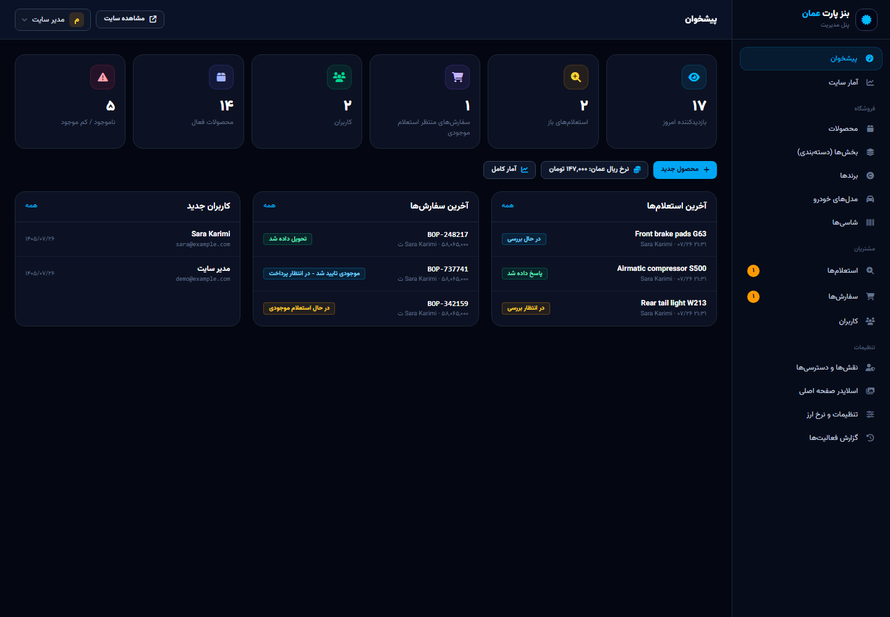
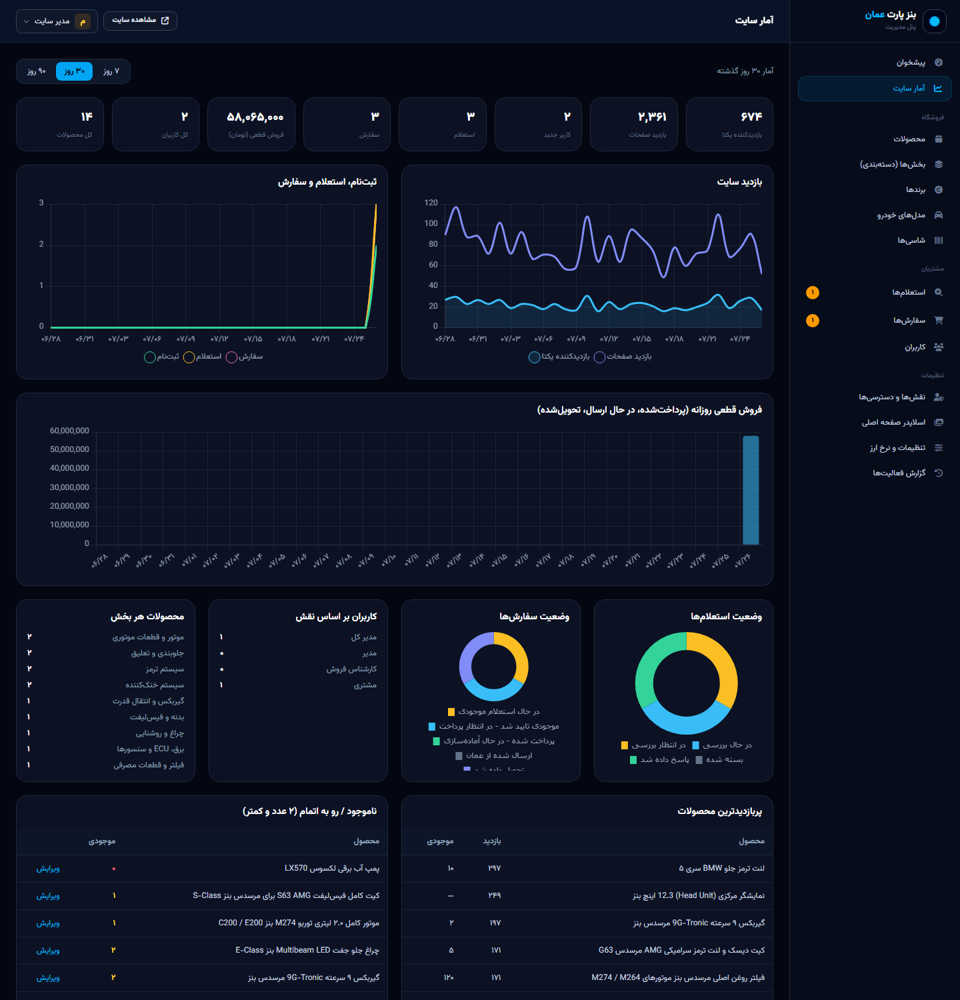
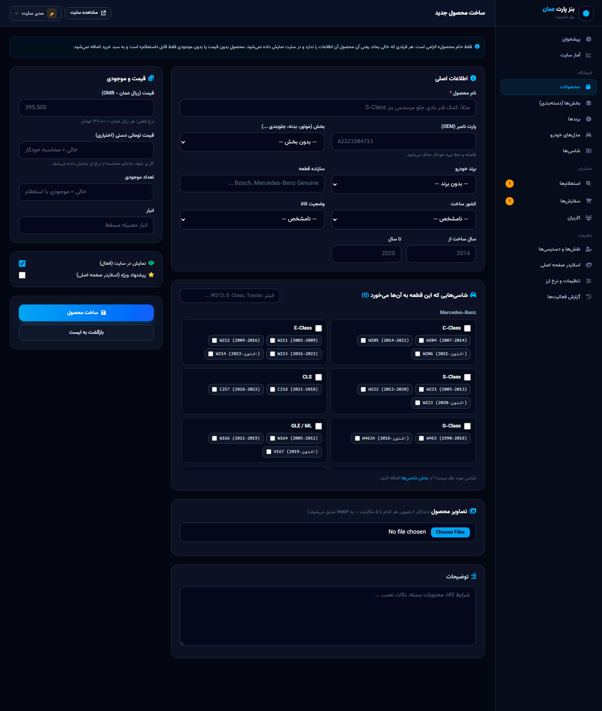
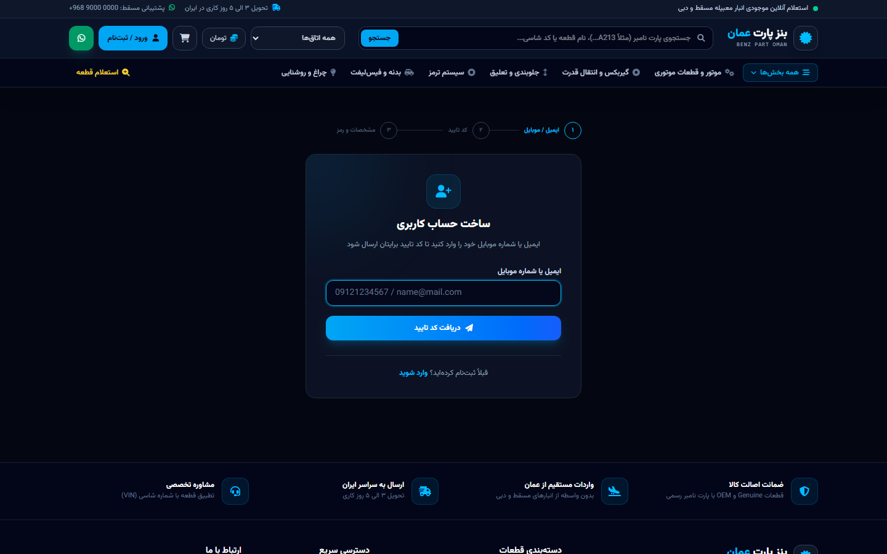

<div align="center">

# Benz Part Oman

**A full-stack e-commerce & parts-inquiry platform for importing genuine Mercedes-Benz (and other) car parts from Oman to Iran.**

Persian (RTL) storefront · dual currency (Toman / Omani Rial) · OTP sign-up · role-based admin panel


</div>

> **Portfolio showcase.** This repository is published so the code and design can be reviewed.
> It is **not** open-source: see [LICENSE](LICENSE). No credentials, databases, customer data or
> production configuration are included.

---

## Screenshots

| Storefront (desktop) | Storefront (mobile) |
|---|---|
|  |  |

| Catalog with filters | Product page |
|---|---|
|  |  |

| Admin dashboard | Site statistics |
|---|---|
|  |  |

| Product editor | OTP registration |
|---|---|
|  |  |

---

## The problem it solves

Genuine parts for luxury cars are hard to find in Iran, while warehouses in Muscat and Dubai stock them.
The business needed one place where Iranian customers can:

- find the **exact** part for their car (brand → model → **chassis code** such as `W213`, plus production year),
- see prices in **both currencies** (Toman and Omani Rial), recalculated from a single exchange rate,
- send a **VIN / part-number inquiry** when a part isn't listed, and follow the expert's reply,
- place an order that the team first confirms against **live stock in Oman** before any payment.

---

## Features

### Storefront
- Persian RTL UI, dark navy theme, fully responsive, with a mobile bottom navigation bar
- Home page: hero slider, brand marquee, category grid, and several product carousels (Swiper)
- **"Find parts for your car"**: brand → model → chassis selector
- Live search suggestions; part numbers match with or without spaces (`A 222 320 47 13` = `A2223204713`)
- Catalog filters: section, brand, model, chassis, model year, country of origin, condition, in stock
- One-click **Toman ⇄ OMR** switch with no page reload, remembered per visitor
- Cart → checkout flow worded as a **stock inquiry**; payment happens after the team confirms stock
- Inquiry form (VIN, part number, photo upload), WhatsApp deep links and Persian error pages

### Accounts
- **3-step sign-up:** email *or* Iranian mobile → 6-digit verification code → name, username and password
- Login with email, mobile **or** username; password reset by code
- Profile and address editing; changing email or phone requires the current password **and** a code sent to the new address
- "My inquiries" (with the expert's reply and quoted price) and "My orders" (with a progress timeline)

### Admin panel
- Products: every field is optional except the name (empty means "not applicable"), multi-image upload, compatible-chassis picker
- Catalog structure: sections (with sub-sections), brands, car models, chassis codes
- Inquiry handling (reply + quoted price), order workflow with **automatic stock deduction and restore**
- Users: search, view purchases and inquiries, change role, ban or unban
- **Roles & permissions editor** (owner only), home-page slider manager, site settings and exchange rate
- Statistics with Chart.js: privacy-friendly visit counter, sign-ups, inquiries, orders and revenue
- **Audit log** of every admin action

---

## Security highlights

Security was a primary requirement of this project.

| Area | Implementation |
|---|---|
| Verification codes | Stored as **HMAC**, never in plain text · 2-minute expiry · burned after 5 wrong tries · 60 s resend cooldown |
| Brute force & abuse | Rate limits on login, code send/verify, inquiries, checkout and search |
| Authorization | Permission keys in one config file · Gate checks on every admin route · **owner role cannot be granted, edited or banned from the UI** |
| Privilege escalation | An admin can only grant roles whose permissions are a **subset of their own** |
| User identity | Each user has an **immutable 10-digit internal code** (never shown to the user); admin URLs use it instead of sequential IDs |
| Uploads | Every image is **re-encoded with GD to WebP**, which strips EXIF data and anything hidden in the file, and is resized and renamed randomly |
| Browser | Strict **Content-Security-Policy** (all JS bundled locally, no CDNs), `X-Frame-Options`, `nosniff`, Referrer and Permissions policies, HSTS on HTTPS |
| Sessions | Encrypted sessions, regenerated on login · other devices signed out after a password change · banned users are kicked out immediately |
| Data | Mass-assignment protection (`role_id`, `internal_code` and ban fields are not fillable) · soft-deleted products keep order history intact |

Responsible disclosure: see [SECURITY.md](SECURITY.md).

---

## Tech stack

- **Backend:** Laravel 12, PHP 8.2, Eloquent, Form Requests, Gates, rate limiters, Mailables
- **Frontend:** Blade components, Tailwind CSS 4, vanilla JavaScript modules, Swiper 14, Chart.js 4, Font Awesome, Vazirmatn font
- **Build:** Vite 6. Every asset is bundled and self-hosted so the site stays reliable when foreign CDNs are filtered.
- **Database:** MySQL in production, SQLite for local development and tests
- **Testing:** PHPUnit feature tests

## Notable design decisions

- **Single source of price truth:** prices are stored in OMR (3-decimal precision); Toman is derived from an admin-set exchange rate, with an optional manual per-product override.
- **Pluggable SMS:** a `SmsSender` contract with a log driver for development and a ready Kavenegar driver.
- **Shared-hosting friendly:** no queue worker, `proc_open` or SSH is required at runtime.
- **Cache invalidation by model events:** navigation and home-page caches clear automatically when the catalog changes.
- **Jalali (Persian) calendar** conversion implemented in-house, with no extra dependency.

## Project structure

```
app/
├─ Http/Controllers/          Storefront: Home, Product, Search, Cart, Checkout, Inquiry, Page
│  ├─ Auth/                   Login, OTP registration, password reset
│  ├─ Account/                Dashboard, profile, contact change, my inquiries & orders
│  └─ Admin/                  Dashboard, stats, catalog, inquiries, orders, users, roles, settings
├─ Http/Middleware/           SecurityHeaders, EnsureNotBanned, TrackVisit
├─ Models/                    Product, Chassis, CarModel, Brand, Category, Order, Inquiry, Role, ...
├─ Services/                  OtpService, Cart, ImageService, Sms drivers
└─ Support/                   Jalali calendar, identifier normalisation, helpers
config/permissions.php        Every permission in one place
config/shop.php               Statuses, countries, provinces, OTP & admin-path settings
resources/views/              Blade templates (storefront, account, admin, emails)
resources/js/modules/         Sliders, live search, currency switch, cart, OTP UI
tests/Feature/                Auth, admin/authorization and storefront tests
```

---

## Running it locally (for reviewers)

**Requirements:** PHP 8.2+ (`pdo_sqlite`, `mbstring`, `gd` with WebP, `intl`, `fileinfo`), Composer, Node.js 20+

```bash
git clone <this-repo> benz-part-oman && cd benz-part-oman
composer install
npm install && npm run build
cp .env.example .env
php artisan key:generate
```

Create a **local demo** owner account by setting these in `.env`:

```dotenv
SUPER_ADMIN_EMAIL=demo@example.com
SUPER_ADMIN_PASSWORD=choose-a-local-password
OTP_DEBUG_SHOW=true   # local only: shows verification codes on screen
```

```bash
touch database/database.sqlite          # Windows: type nul > database\database.sqlite
php artisan migrate --seed              # roles, demo catalog and sample products
php artisan storage:link
php artisan serve --no-reload
```

Then open <http://127.0.0.1:8000> (admin panel at `/admin`).

### Tests

```bash
php artisan test
```

32 feature tests cover OTP registration, login by email/phone/username, code lock-out, password reset,
privilege-escalation rules, owner protection, product creation with image re-encoding, search, filters,
inquiries, and the checkout → confirm → cancel stock lifecycle.

---

## Roadmap

- Online payment gateway (Zarinpal / Iranian bank gateways) after stock confirmation
- SMS / email notifications when an inquiry is answered or an order status changes
- Two-factor login for staff accounts
- Bulk product import from Excel, wishlist and "notify me when in stock"

---

## Author & license

Designed and developed by **Amirreza Nadimi**.

© 2026. All rights reserved. The source code is published for **viewing and portfolio purposes only**.
Copying, redistribution or commercial use requires written permission. See [LICENSE](LICENSE).

A Persian setup & deployment guide is available in [README.fa.md](README.fa.md).
